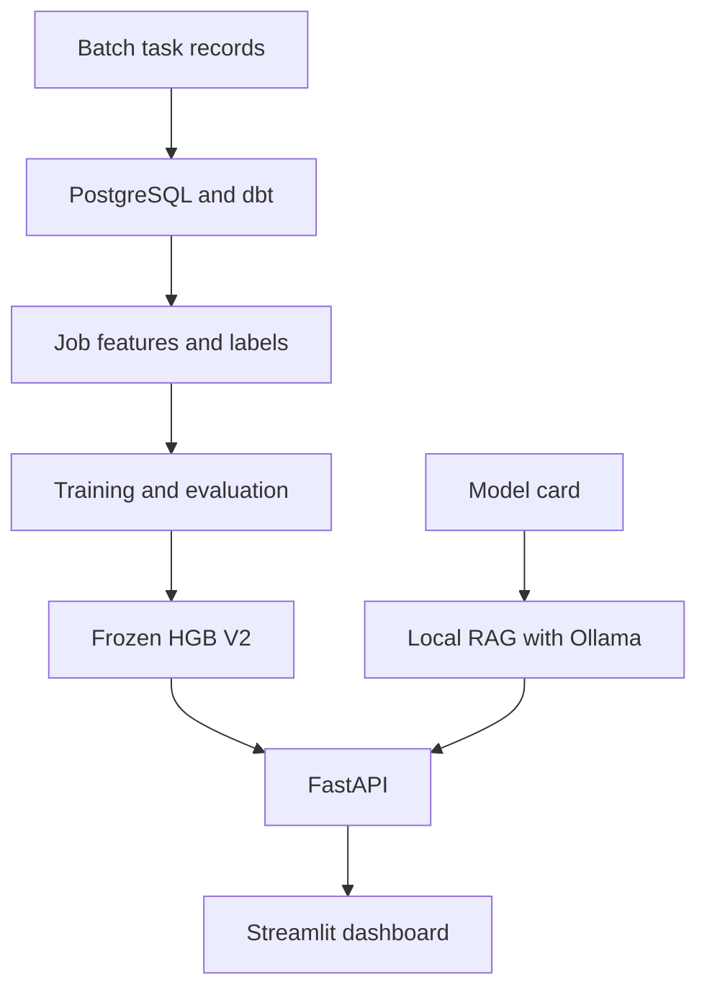

# DataFlow Sentinel

An experimental portfolio project for scoring batch-job failure risk and answering questions about the documented model.

The project combines a PostgreSQL and dbt data pipeline, chronological machine-learning evaluation, a FastAPI prediction service, a Streamlit dashboard, and a local retrieval-augmented generation (RAG) assistant.

## What the application does

- Aggregates task records into job-run features and failure labels.
- Scores individual jobs or batches using a frozen HistGradientBoosting model.
- Displays alerts, saved evaluation results, and cohort analysis.
- Provides a business simulator based on explicit cost and intervention assumptions.
- Answers documentation questions with source references and supporting quotations.

The current model is experimental. Its scores are uncalibrated and must not be interpreted as failure probabilities.

## Architecture



## Data and prediction target

The processed snapshot contains 14,295,731 task records and 4,161,396 labeled job runs.

The prediction unit is a job run:

- `failed_job = 1`: at least one task failed.
- `failed_job = 0`: all tasks terminated successfully.
- Jobs without a resolved target are excluded from the labeled dataset.

HGB V2 uses 12 features covering task count, planned CPU and memory aggregates, missing-value flags, total instances, and task-type grouping.

Job identifiers, target labels, and split timestamps are excluded from the model feature matrix. The source data does not independently verify that all aggregated features were available before execution; pre-run availability is therefore unverified.

## Model evaluation

The data was split chronologically. The alert threshold was selected on Validation and kept fixed for Test.

**Frozen threshold:** `0.9696205830070223`

An alert is raised when `score >= threshold`.

| Split | Jobs | Average Precision | Precision | Recall | F1 |
|---|---:|---:|---:|---:|---:|
| Validation | 623,763 | 0.5169 | 0.5240 | 0.9022 | 0.6629 |
| Test | 624,196 | 0.1948 | 0.1235 | 0.5111 | 0.1989 |

| Split | Actual failures | Alerts | True alerts | False alerts | Missed failures |
|---|---:|---:|---:|---:|---:|
| Validation | 26,663 | 45,910 | 24,056 | 21,854 | 2,607 |
| Test | 4,790 | 19,826 | 2,448 | 17,378 | 2,342 |

Performance declined on Test. For example, Test precision was 12.35%, so most alerts were false positives.

These results support further experimentation rather than production deployment. The inspected Test set should not be reused as an untouched evaluation set for future model changes.

## Local knowledge assistant

The current knowledge base contains one model card, split into six chunks.

- Generation model: `qwen3:4b-instruct-2507-q4_K_M`
- Embedding model: `embeddinggemma:300m-bf16`
- Embedding dimension: 768
- Retrieval: cosine similarity over normalized vectors stored in a JSON index
- Retrieved context: up to three chunks per question
- Output: up to two statements with source IDs and supporting quotes

Source hashes are checked to detect changed documents. Generated responses are checked for valid structure, retrieved source IDs, and matching quotations.

These checks do not guarantee that every generated claim is supported by its quotation. The current checks are small functional examples, not a comprehensive RAG quality benchmark.

Individual job logs are not included in the knowledge base. In the tested unknown-job example, the assistant returned `answerable: false` with an empty statements list.

Inference runs locally through Ollama and does not require a paid inference API.

## Project layout

| Path | Purpose |
|---|---|
| `src/ingestion/` | Data ingestion and PostgreSQL loading |
| `src/validation/` | Data-contract and quality checks |
| `dbt/dataflow_dbt/` | Staging, job aggregation, features, and dbt tests |
| `notebooks/` | Exploration, training, and evaluation |
| `src/ml/` | Frozen-model inference |
| `api/app/` | Prediction and RAG endpoints |
| `dashboard/` | Streamlit application |
| `docs/knowledge_base/` | Indexed documentation |
| `scripts/` | Startup, smoke checks, and RAG preparation |
| `artifacts/models/` | Saved model, metadata, and evaluation outputs |
| `artifacts/rag/` | Prepared chunks and vector index |
| `tests/` | Automated test code |

## Run the existing local demo

### Prerequisites

The commands below assume:

- Windows PowerShell, opened in the project root.
- The existing Python 3.12 `.venv`, with ML dependencies matching the saved model metadata.
- The saved model folder:
  `artifacts/models/hgb_v2_20261002T104801_398392Z`
- The SHAP reference background:
  `artifacts/explainability/shap_train_background_representative.csv`
- Ollama running locally at `http://127.0.0.1:11434`.

The API and dashboard requirements files add application dependencies. They are not a complete dependency lock for rebuilding the training environment.

Running the demo from saved artifacts does not require querying PostgreSQL. Rebuilding the training data requires the source dataset, configured database, and dbt environment.

### Prepare application dependencies and RAG artifacts

Run these commands when setting up the application or rebuilding its RAG index:

```powershell
.\.venv\Scripts\python.exe -m pip install -r .\requirements-model.txt -r .\requirements-api.txt -r .\requirements-dashboard.txt

ollama pull qwen3:4b-instruct-2507-q4_K_M
ollama pull embeddinggemma:300m-bf16

.\.venv\Scripts\python.exe .\scripts\prepare_rag_chunks.py
.\.venv\Scripts\python.exe .\scripts\embed_rag_chunks.py
```

After editing knowledge-base documents, run both RAG preparation scripts again.

### Terminal 1: API

```powershell
$env:SENTINEL_MODEL_PATH = (Resolve-Path ".\artifacts\models\hgb_v2_20261002T104801_398392Z").Path
$env:SENTINEL_EXPLANATION_BACKGROUND = (Resolve-Path ".\artifacts\explainability\shap_train_background_representative.csv").Path

.\.venv\Scripts\python.exe -m uvicorn api.app.main:app --host 127.0.0.1 --port 8000 --workers 1 --no-access-log
```

Keep this terminal running.

Interactive API documentation: http://127.0.0.1:8000/docs

### Terminal 2: dashboard

Open another PowerShell terminal in the project root:

```powershell
.\.venv\Scripts\python.exe .\scripts\start_dashboard.py --skip-install
```

Open http://127.0.0.1:8501.

The startup script checks the API connection, model identity, and saved evaluation counts.

Start one instance of each service. To restart a service, press `Ctrl+C` in its running terminal before launching it again.

## API endpoints

| Method | Path | Purpose |
|---|---|---|
| GET | `/health` | Prediction-service health |
| GET | `/model-info` | Model identity, threshold, and feature schema |
| POST | `/predict` | Score one job |
| POST | `/predict/batch` | Score a batch of jobs |
| POST | `/rag/ask` | Answer a documentation question |

Example request body for `/rag/ask`:

```json
{
  "question": "What is the alert threshold for HGB V2?"
}
```

Use the interactive API documentation for the prediction input schema.

## Verification performed

- Compared 1,000 inference predictions against the notebook: scores, threshold, and alert decisions matched.
- Passed the API smoke check for health, model information, single prediction, batch prediction, and invalid input.
- Passed dashboard startup checks for API connectivity and saved model results.
- Checked RAG answers for the threshold, Test precision, and interpretation of uncalibrated scores.
- Checked the dashboard display of a cited answer and an insufficient-information response.

To rerun the prediction API smoke check while the API is running:

```powershell
.\.venv\Scripts\python.exe .\scripts\smoke_test_api.py
```

To ask the local RAG assistant directly:

```powershell
.\.venv\Scripts\python.exe .\scripts\ask_rag.py "What is the alert threshold for HGB V2?"
```

## Interpretation limits

- An alert indicates that the model score reached the threshold; it does not prove that a job will fail.
- Local SHAP values provide model attributions relative to a Train-only reference background; they do not establish causal failure reasons.
- Recommended checks are review suggestions, not established causes.
- The business simulator depends on user-supplied assumptions; its results are not measured savings.
- The knowledge assistant currently uses the HGB V2 model card and the Job-failure investigation runbook, with retrieved-source citations and abstention for unsupported questions.

## Training notebook and model dependencies

[HGB V2 training notebook](notebooks/02_hgb_v2_training.ipynb) covers
chronological splits, label availability, baselines, threshold selection,
Test evaluation, artifact saving, and inference parity.

Retained notebook outputs are from the original recorded run. Edited cells
have no saved outputs; the curated notebook has not been rerun end-to-end.
The original mixed exploration notebook is kept locally and excluded from Git.

`requirements-model.txt` pins the core ML packages used by the saved artifact and the SHAP runtime dependency. Python 3.12.10 was used for that artifact. These pins are not a
complete training-environment lock. Training also requires the source data,
configured PostgreSQL/dbt models, python-dotenv, psycopg, and a Jupyter kernel.
